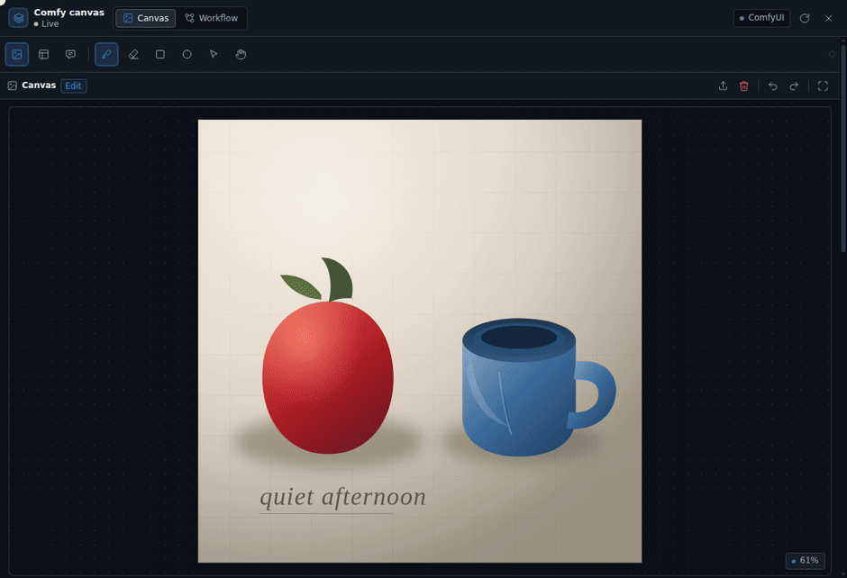
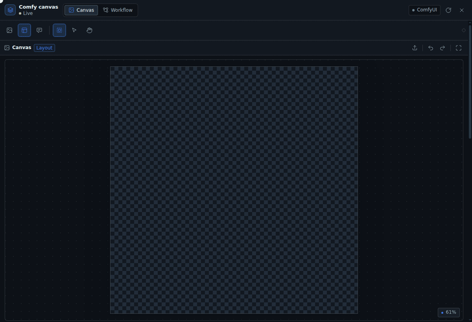

[中文](README.md) · English · [日本語](README.ja.md)

# DSH Comfy Cowork

Open a canvas in the DSH right sidebar so a human and an agent share one canvas state, wired straight into ComfyUI.

- The canvas is shared state, not a chat attachment: the agent reads the masks you paint, the boxes you draw, and the prompt you write; prompts the agent writes land in the same text box.
- Outputs feed ComfyUI directly: masks are PNGs ComfyUI can read, layouts are JSON MOSS-Image can use as conditioning, and the workflow is the one ComfyUI saved itself.
- Local first: images move only between the browser, DSH, and the ComfyUI on your machine.

UI languages: Chinese, English, Japanese. Other languages fall back to English.

## Demos

### The agent writes prompts and sets up the workflow


Prompts go into the plugin's prompt box instead of staying in chat. The workflow view lets you browse the node graph and edit parameters on a selected node.

### Local fixes: paint a precise mask



Brush, eraser, rectangle, and ellipse all paint one mask. Feather, grow, and invert it, then export a PNG ComfyUI can use as-is.

### Layout planning (MOSS-Image)



Draw boxes on a blank canvas, write a caption and visible text per box, and the prompt box becomes the compiled one-line layout JSON as you go.

### Comment annotations


Circle the problem on the image and write how to fix it. The agent reads that region's screenshot and text and edits the image accordingly.

## Install

The plugin installs into a DSH profile as a bundle. Use `plugin_manager`:

```text
plugin_manager(action: "install_bundle", target: "github:<owner>/dsh-comfy-cowork")
```

For local development you can point at the repository directory:

```text
plugin_manager(action: "install_bundle", target: "/path/to/dsh-comfy-cowork")
```

Refresh the DSH page and type `/dsh-comfy-cowork` in a chat. The right sidebar opens the canvas and connects the `comfy_coworking_*` tools to that chat's agent; closing the canvas tab removes them. Other chats never see these tools.

The default connection is `http://127.0.0.1:8188`. To change it, edit `baseUrl` in `cordis.patch.yml`, or override `config.baseUrl` on the `comfy-cowork` row in the profile's patch layer.

## Usage

### Local image edits

1. Load an image into the canvas: file picker, drag and drop, paste, or a ComfyUI result.
2. Paint a mask with the brush, eraser, rectangle, or ellipse; adjust size, hardness, and opacity.
3. Adjust feather, grow/shrink, and invert. The mask shows as a red overlay.
4. On the Workflow page, load a workflow that contains `LoadImage` / `LoadImageMask`. Injection bindings are inferred from node types and links; to override one, set the injection binding in the node properties.
5. Set the seed and click "Queue run". The result appears below; use "Use as canvas" to keep iterating.

### Blank layout (MOSS-Image)

1. Switch to Layout mode and set the canvas width and height (MOSS requires multiples of 16).
2. Draw a bbox with the box tool; pick `object` / `character` / `text` per box, write a caption, and for `text` boxes write the visible text.
3. The prompt box becomes the compiled layout JSON; you can also edit it by hand. The negative prompt goes in its own box and is injected into the text node wired to the sampler's `negative` input at run time.
4. Load a workflow with `CreateBoundingBoxes` + `MOSSImageLayoutPrompt` and run it. With only `CLIPTextEncode`, the plugin injects the compiled JSON directly.

Layout boxes only matter to MOSS-Image; models such as anima and SDXL use the prompt box and a normal workflow.

### Working with the agent

| Tool | What it does |
|---|---|
| `comfy_coworking_state` / `health` | Read the canvas, prompt, layout, bindings, and run history; check the connection |
| `comfy_coworking_set_prompt` | Write the prompt or negative prompt |
| `comfy_coworking_set_layout` / `upsert_box` / `remove_box` | Replace the layout; add, update, or delete boxes |
| `comfy_coworking_set_canvas` / `load_image` | Set size and mode; load a workspace image into the canvas |
| `comfy_coworking_list_workflows` / `load_workflow` / `bind_workflow` | Browse, load, and rebind workflows |
| `comfy_coworking_list_models` | List model folders and files |
| `comfy_coworking_run` / `run_status` / `interrupt` | Run, check status, cancel |
| `comfy_coworking_open_canvas` | Ask the UI to open the canvas |
| `comfy_coworking_comments` | Read comment annotations and their screenshots |

Every prompt write lands in `document.prompt`, the text box the user sees.

## Storage

```text
<workspace>/.comfy-cowork/<sessionId>/
  document.json        # canvas, prompt, layout, workflow, run history
  assets/
    canvas.png         # current canvas image
    source.png         # original imported image
    mask.png           # white = editable area
    canvas_rgba.png    # alpha = 1 - mask, for LoadImage's MASK output
    run-*.png/mp4      # run outputs
  runs/
```

## Compatibility

- ComfyUI's `LoadImage` `MASK` output is **1 - alpha**. `canvas_rgba.png` is already inverted this way; `mask.png` keeps white = editable area and suits `LoadImageMask`.
- MOSS compilation matches `comfy_extras/nodes_moss_image.py` byte for byte:
  `{"summary":{"caption":…},"items":[{"label":…,"caption":…,"bbox":[y1-H/2,x1-W/2,y2-H/2,x2-W/2]}],"bbox_coord_space":"abs_centralized","bbox_format":"yxyx"}`.
- `CreateBoundingBoxes` declares `editor_state` as a list, but the API validator treats lists as links; the plugin sends the string `"[]"` and passes the actual boxes in the `bboxes` JSON.
- The browser never talks to ComfyUI directly: requests carrying an `Origin` header get a 403. The DSH Host proxies every request.

## Development

```bash
npm install     # esbuild + React, development and tests only
npm run build   # writes client.js (committed)
npm test        # node:test, 38 tests
```

- Host: `index.js` → `lib/plugin.js`; tools in `lib/tools.js`, routes in `lib/routes.js`, workflow conversion in `lib/workflow.js`, MOSS compilation in `lib/moss.js`.
- Client: `src/client/`, bundled into `client.js` by esbuild; entry `entry.jsx`, canvas `CanvasStage.jsx`, workflow `WorkflowView.jsx`.
- Browser fixtures live in `tests/harness/` and are not part of the runtime package.
- After a Host change, toggle `include:comfy-cowork` off and on with `plugin_manager`. After a Client change, rebuild and refresh the page.

Requirements: [docs/REQUIREMENTS.en.md](docs/REQUIREMENTS.en.md).

## Limitations

- Subgraph workflows are rejected with an explicit error; they are not supported yet.
- API-format workflows can run and save, but the graph view is read-only.
- One ComfyUI server; multiple profiles are planned for a later version.
- Video uses generic workflow runs and preview only; there is no timeline.
- Large images keep masks at full resolution; shrink the canvas first above 4K.
