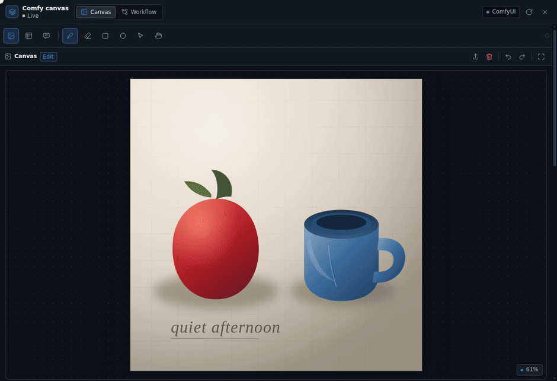
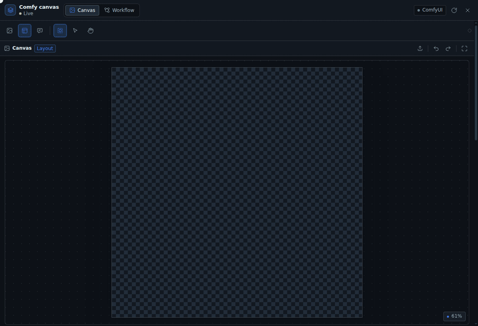

# DSH Comfy Cowork

[English](README.md) · [中文](README.zh.md) · 日本語

DSH の右サイドバーにキャンバスを開き、人と agent が同じキャンバス状態を共有し、ComfyUI に直接つながります。

- キャンバスは共有状態であり、チャットの添付ファイルではありません。人が描いたマスク、引いた枠、書いたプロンプトを agent が読めます。agent が書いたプロンプトは同じ入力欄に入ります。
- 成果物はそのまま ComfyUI に渡ります。マスクは ComfyUI が読める PNG、レイアウトは MOSS-Image がそのまま conditioning として使える JSON、ワークフローは ComfyUI 自身が保存したものです。
- ローカル優先です。画像はブラウザ、DSH、本機の ComfyUI の間だけを流れます。

UI の言語：中国語、英語、日本語。その他の言語は英語にフォールバックします。

## デモ

### Agent がプロンプトを書き、ワークフローを組む


プロンプトはプラグインのプロンプト欄に書かれ、チャットにだけ残ることはありません。ワークフロー画面ではノードグラフを閲覧し、ノードを選んでパラメータを変更できます。

### 部分修正：手描きの精密マスク



ブラシ、消しゴム、矩形、楕円は同じ 1 枚のマスクに描きます。ぼかし、拡張、反転のあと、ComfyUI がそのまま使える PNG として書き出します。

### レイアウト編成（MOSS-Image）



空のキャンバスに枠を引き、枠ごとに caption と表示テキストを書くと、プロンプト欄がリアルタイムでコンパイル済みの 1 行 layout JSON に変わります。

### コメント注釈


画像上で問題の箇所を囲み、修正方法を書きます。agent はその範囲のスクリーンショットとテキストを読み、注釈に沿って画像を修正します。

## インストール

DSH の「プラグイン」ページで「プラグインを追加」を選び、パッケージ名 `dsh-comfy-cowork` を入力します。インストール元はデフォルトの npm のままインストールします。

パッケージにはビルド済みのクライアントファイルが含まれるため、インストールする側に Node もビルドもインストールスクリプトの許可も不要です。

DSH のページを更新し、チャットで `/dsh-comfy-cowork` と入力します。右サイドバーにキャンバスが開き、同時にこのセッションの agent に `comfy_coworking_*` ツールが接続されます。他のセッションからはこれらのツールは見えません。

キャンバスを閉じてもツールは外れません。モデルが見るツール一覧が変わらないため、プロンプトキャッシュがそのまま効きます。ツールを外せるのはアプリバーの専用ボタンだけで、押す前に警告が出ます。ツール一覧が変わると、会話全体が一度キャッシュなしで処理し直されるためです。会話が長い場合は、外す前に圧縮してください。

デフォルトでは `http://127.0.0.1:8188` に接続します。接続先はキャンバスで変更します。インスペクタの「ComfyUI」欄に新しいアドレスを入れて保存すると `<workspace>/.comfy-cowork/config.json` に書き込まれ、再起動なしで切り替わります。同じワークスペースのチャットと agent ツールがそのアドレスを使います。

## 使い方

会話の最初にキャンバスを開いてください。会話の途中でツールを有効にするとリクエストのプレフィックスが変わり、会話全体が一度キャッシュなしで処理し直されます。そのため、すでにメッセージがあるチャットでは確認ダイアログが出ます。途中で有効にする場合は、先に会話を圧縮してください。

### 部分的な画像修正

1. キャンバスに画像を読み込みます：ファイル選択、ドラッグ＆ドロップ、貼り付け、または ComfyUI の結果からの取り込み。
2. ブラシ、消しゴム、矩形、楕円でマスクを描きます。太さ、硬さ、不透明度を調整します。
3. ぼかし、拡張/収縮、反転を調整します。マスクは赤で重ねて表示されます。
4. 「ワークフロー」画面で `LoadImage` / `LoadImageMask` を含むワークフローを読み込みます。注入バインディングはノードの種類と接続から自動で推論されます。上書きする場合はノードのプロパティで「キャンバス注入」を設定します。
5. シードを入力し、「キューに追加」をクリックします。結果が下に表示され、「キャンバスに反映」で反復を続けられます。

### 空のレイアウト（MOSS-Image）

1. 「レイアウト」モードに切り替え、キャンバスの幅と高さを設定します（MOSS は 16 の倍数を要求します）。
2. 「ボックス」で bbox を描きます。各枠で `object` / `character` / `text` を選び、caption を書きます。`text` の場合はさらに表示テキストを書きます。
3. プロンプト欄は自動でコンパイル済みの layout JSON になります。手で編集することもできます。ネガティブプロンプトは別の欄に書き、実行時にサンプラーの `negative` に接続されたテキストノードへ注入されます。
4. `CreateBoundingBoxes` + `MOSSImageLayoutPrompt` を含むワークフローを読み込んで実行します。`CLIPTextEncode` のみの場合は、プラグインがコンパイル済み JSON を直接注入します。

レイアウト枠は MOSS-Image でのみ意味を持ちます。anima、SDXL などのモデルはプロンプト欄で通常のワークフローを実行します。

### Agent との協働

| ツール | 役割 |
|---|---|
| `comfy_coworking_state` / `health` | キャンバス、プロンプト、レイアウト、バインディング、実行履歴の読み取り。接続の確認 |
| `comfy_coworking_set_prompt` | プロンプトまたはネガティブプロンプトを書く |
| `comfy_coworking_set_layout` / `upsert_box` / `remove_box` | レイアウトの置換、枠の追加・変更・削除 |
| `comfy_coworking_set_canvas` / `load_image` | サイズとモードの設定。ワークスペースの画像をキャンバスに読み込む |
| `comfy_coworking_list_workflows` / `load_workflow` / `bind_workflow` | 閲覧、読み込み、バインディングの変更 |
| `comfy_coworking_list_models` | モデルカタログとファイルの一覧 |
| `comfy_coworking_run` / `run_status` / `interrupt` | 実行、状態確認、キャンセル |
| `comfy_coworking_open_canvas` | UI にキャンバスを開くよう要求 |
| `comfy_coworking_comments` | コメント注釈と対応するスクリーンショットの読み取り |

すべてのプロンプト書き込みは `document.prompt`、つまりユーザーが目にする入力欄に反映されます。

## 保存

```text
<workspace>/.comfy-cowork/<sessionId>/
  document.json        # キャンバス、プロンプト、レイアウト、ワークフロー、実行履歴
  assets/
    canvas.png         # 現在のキャンバス元画像
    source.png         # インポートした元画像
    mask.png           # 白 = 編集領域
    canvas_rgba.png    # alpha = 1 - mask、LoadImage の MASK 出力用
    run-*.png/mp4      # 実行の出力
  runs/
```

## 互換性

- ComfyUI `LoadImage` の `MASK` 出力は **1 - alpha** です。`canvas_rgba.png` はこれに合わせて反転済みです。`mask.png` は白 = 編集領域のままで、`LoadImageMask` に適しています。
- MOSS コンパイルは `comfy_extras/nodes_moss_image.py` とバイト単位で一致します：
  `{"summary":{"caption":…},"items":[{"label":…,"caption":…,"bbox":[y1-H/2,x1-W/2,y2-H/2,x2-W/2]}],"bbox_coord_space":"abs_centralized","bbox_format":"yxyx"}`。
- `CreateBoundingBoxes` の `editor_state` は list 型ですが、API 検証は list を link として扱います。プラグインは `"[]"` 文字列を送信し、実際の枠は `bboxes` JSON で渡します。
- ブラウザは ComfyUI に直接接続しません。`Origin` 付きのリクエストは 403 になります。すべてのリクエストは DSH Host がプロキシします。

## 開発

```bash
npm install     # esbuild + React（開発とテスト専用）
npm run build   # client.js を生成（gitignore 済みのビルド成果物）
npm test        # node:test、38 件
```

- Host：`index.js` → `lib/plugin.js`。ツールは `lib/tools.js`、ルートは `lib/routes.js`、ワークフロー変換は `lib/workflow.js`、MOSS コンパイルは `lib/moss.js`。
- Client：`src/client/`、esbuild で `client.js` にバンドル。エントリは `entry.jsx`、キャンバスは `CanvasStage.jsx`、ワークフローは `WorkflowView.jsx`。
- ブラウザ用フィクスチャは `tests/harness/` にあり、ランタイムパッケージには含まれません。
- Host コードを変更したら、`plugin_manager` で `include:comfy-cowork` をオフにしてからオンにします。Client コードを変更したら再ビルドしてページを更新します。
- ローカル開発版のインストール：`plugin_manager(action: "install_bundle", target: "/path/to/dsh-comfy-cowork")`。
- `client.js` はビルド成果物でコミットしません。`npm install` 時に `prepare` が自動でビルドします。
- 公開：`npm publish`。`prepack` が先に `client.js` をビルドしてテストを実行します。

要件ドキュメント：[docs/REQUIREMENTS.ja.md](docs/REQUIREMENTS.ja.md)。

## 制限

- サブグラフのワークフローは明示的にエラーになり、未対応です。
- API 形式のワークフローは実行と保存ができますが、グラフ表示は読み取り専用です。
- ComfyUI サーバーは 1 台のみ。複数 profile は今後のバージョンです。
- 動画は汎用ワークフローの実行とプレビューのみで、タイムラインはありません。
- 大きな画像のマスクはフル解像度で処理します。4K 以上は先にキャンバスを縮小することをおすすめします。

## クレジット

UI デザインには [ui-ux-pro-max](https://github.com/nextlevelbuilder/ui-ux-pro-max-skill) スキルを使用しました。ドキュメントの執筆には [Agent Toolkit](https://github.com/softaworks/agent-toolkit) の `writing-clearly-and-concisely` スキルを使用しました。

## ライセンス

MIT。[LICENSE](LICENSE) を参照。
