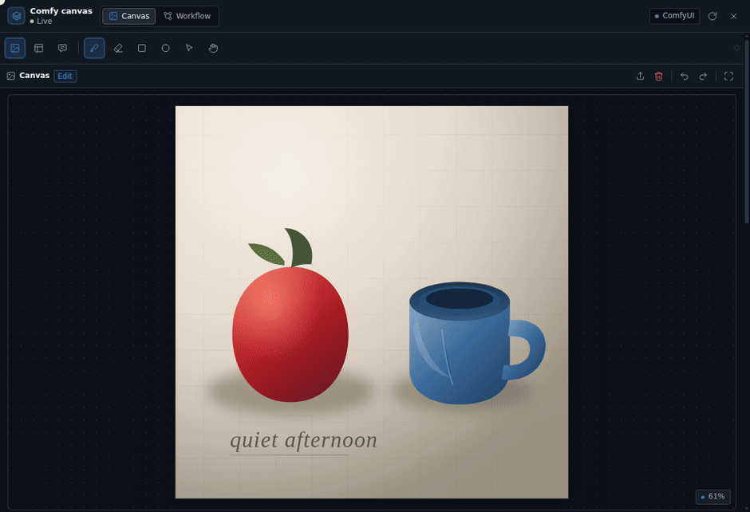
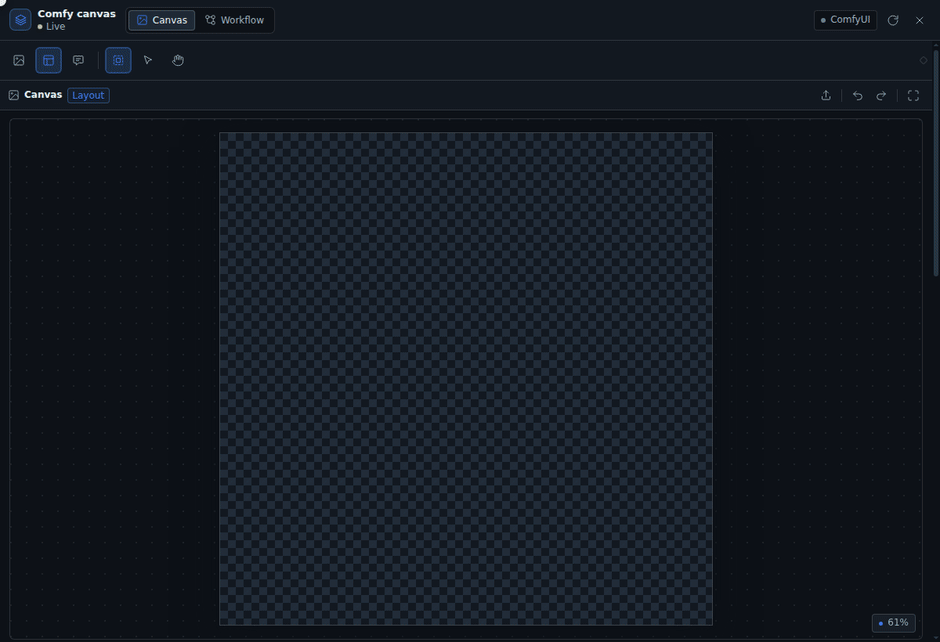

# DSH Comfy Cowork

English · [中文](README.zh.md) · [日本語](README.ja.md)

Open a canvas in the DSH right sidebar so a human and an agent share one canvas state, wired straight into ComfyUI.

- The canvas is shared state, not a chat attachment: the agent reads the masks you paint, the boxes you draw, and the prompt you write; prompts the agent writes land in the same text box.
- Outputs feed ComfyUI directly: masks are PNGs ComfyUI can read, layouts are JSON MOSS-Image can use as conditioning, and the workflow is the one ComfyUI saved itself.
- Local first: images move only between the browser, DSH, and the ComfyUI on your machine.

UI languages: Chinese, English, Japanese. Other languages fall back to English.

## Demos

### The agent writes prompts and sets up the workflow


Prompts go into the plugin's prompt box instead of staying in chat. The workflow view lets you browse the node graph and edit parameters on a selected node.

### Local fixes: paint a precise mask



Brush, eraser, rectangle, and ellipse all paint one mask. Feather and grow it, then export a PNG ComfyUI can use as-is.

### Layout planning (MOSS-Image)



Draw boxes on a blank canvas, write a caption and visible text per box, and the prompt box becomes the compiled one-line layout JSON as you go. The whole-image caption is a box too: draw one, set its type to `summary`, and write the overall scene there — exactly one is allowed.

### Comment annotations


Circle the problem on the image and write how to fix it. The agent reads that region's screenshot and text and edits the image accordingly.

## Install

Open the Plugins page in DSH, choose **Add plugin**, enter the package name `dsh-comfy-cowork`, keep the default npm source, and install.

The package ships its built client bundle: the installing machine needs no Node, no build step, and no build-script approval.

Refresh the DSH page and type `/dsh-comfy-cowork` in a chat. The right sidebar opens the canvas and connects the `comfy_cowork` tool to that chat's agent. Other chats never see this tool.

Closing the canvas keeps the tools with that chat, so the model's tool list stays byte-identical and the prompt cache keeps hitting. The **Canvas tools** section in the inspector removes them; it warns first, because a changed tool list reprocesses the whole conversation once without a cache hit. Compact the chat before unloading if it is long.

The canvas connects to `http://127.0.0.1:8188` by default. Change it in the canvas: the **ComfyUI** section of the inspector takes any address, saves it to `<workspace>/.comfy-cowork/config.json`, and switches the running plugin immediately — no restart. Every chat in that workspace and the agent tools follow it.

## Usage

Open the canvas at the start of a chat. Turning the tools on later in a conversation rewrites the request prefix and costs one full-context cache miss, so the canvas asks for confirmation when a chat already has messages. Compact the chat first if you must.

### Local image edits

1. Load an image into the canvas: file picker, drag and drop, paste, or a ComfyUI result.
2. Paint a mask with the brush, eraser, rectangle, or ellipse; adjust the brush size. The mask is a stencil, so a stroke always paints a hard, full-alpha edge and there is no brush hardness or opacity; feather is the only thing that softens it. **Overlay opacity** next to the brush only changes how strong the red tint looks.
3. Adjust repaint strength, feather, and grow/shrink. The mask is always shown as a red overlay (there is no show/hide switch), and a small **?** next to each control explains it on hover.
4. Every separate painted area is a **region** with its own local repaint prompt: numbered badges mark them, and double-clicking a region edits its prompt in place (same in-place editor as boxes and comments). A run repaints the regions one by one in paint order, chaining the image, so the whole-image prompt keeps describing the image. Leave a region's prompt empty and that pass repaints with an empty prompt — a mask run never falls back to the whole-image prompt.
5. On the Workflow page, load a workflow that contains `LoadImage` / `LoadImageMask`. Injection bindings are inferred from node types and links; to override one, set the injection binding in the node properties.
6. Set the seed and click "Queue run". The run panel says which region it is on and what each pass asked for, plus the repaint strength; the result of the last pass appears below; use "Use as canvas" to keep iterating.

For a change to one small area, use an **inpaint-at-full-resolution** graph (the A1111-style shape): `LoadImageMask` → `ImageCropByMaskAndResize` (crop the painted bbox to ~1024 with padding) → `GrowMaskWithBlur` → `SetLatentNoiseMask` → `KSampler` at denoise 0.75–0.85 → `VAEDecode` → `ImageUncropByMask` back into the original. Sampling the whole 1920×1080 latent instead leaves a small mask with only a few latent pixels, and the model all but ignores the prompt there. Denoise is the strength knob: low keeps the old content, high invents a new object. The mask section's **Repaint strength** is that knob (stored as `mask.denoise`): every mask pass writes it into the bound sampler's `denoise`, so you can try 0.5 and 0.85 without editing the workflow.

With several painted regions the graph runs once per region: the plugin queues them in paint order, feeds each pass's output in as the next pass's image, and keeps the last result. That means a run costs as many samples as there are regions.

### Blank layout (MOSS-Image)

1. Switch to Layout mode and set the canvas width and height (MOSS requires multiples of 16).
2. Draw a bbox with the box tool; pick `object` / `character` / `text` per box, write a caption, and for `text` boxes write the visible text. The whole-image caption is one of these boxes too: set its type to `summary` (only one allowed) and write the overall scene there, not in the prompt box.
3. The prompt box becomes the compiled layout JSON; you can also edit it by hand. The negative prompt goes in its own box and is injected into the text node wired to the sampler's `negative` input at run time.
4. Load a workflow with `CreateBoundingBoxes` + `MOSSImageLayoutPrompt` and run it. With only `CLIPTextEncode`, the plugin injects the compiled JSON directly. The canvas width and height are written into the node that sizes the latent, so the render uses the canvas resolution.

Layout boxes only matter to MOSS-Image; models such as anima and SDXL use the prompt box and a normal workflow.

### Models and workflows

The agent browses models the way it browses files: the `list_models` feature first returns the folders (`checkpoints`, `loras`, `vae`, …) with file counts, then one folder returns its files. Those file names are exactly what a loader widget takes — `Illustrious/model.safetensors`, no folder prefix, never an absolute path. The list is a snapshot cached in `.comfy-cowork/models.json`; it is rebuilt only when it is missing, after the ComfyUI address changes, or when the `refresh` feature (or the canvas's **Refresh directories** button) asks for it. Nothing expires on a timer.

The node directory at `.comfy-cowork/nodes.json` mirrors ComfyUI's own node palette as a category tree: browse top-level categories with counts, then subcategories, then the nodes filed there, or search type, display name, category, and description. It keeps names and descriptions only, no input schemas. The same `refresh` feature or **Refresh directories** button rebuilds this tree — and a ComfyUI address change discards it — never a timer. The `node_info` feature reads one node type's definition live from ComfyUI — inputs, defaults, ranges, tooltips, and dropdown values paged 100 at a time — so a schema is never stale.

Workflows come from three places and are listed together by the `list_workflows` feature: ComfyUI's own `userdata/workflows`, the comfy skill's project convention (`fragments/*.json`, `blueprints/*.compiled.json`), and whatever this plugin saved in `.comfy-cowork/workflows`. Saving writes to the workspace by default; **Save as** can also write back into ComfyUI.

### Working with the agent

The plugin registers one tool, `comfy_cowork`, with three actions instead of one tool per capability:

- `discover` — with no other argument, lists the five feature groups; `group` expands one, and `query` searches names, aliases (English and Chinese), and descriptions.
- `describe` — returns the input schema of one or more features.
- `execute` — runs one feature with an `arguments` object.

Feature schemas exist only in `describe` results, never in the request's tool list. A first turn looks like this:

```text
comfy_cowork {"action": "discover"}
comfy_cowork {"action": "discover", "group": "canvas"}
comfy_cowork {"action": "describe", "features": ["set_prompt"]}
comfy_cowork {"action": "execute", "feature": "set_prompt", "arguments": {"prompt": "…"}}
```

Once the feature ids are known, `execute` alone is enough. The five groups:

| Group | Features | What it covers |
|---|---|---|
| `canvas` | `state`, `open_canvas`, `set_canvas`, `set_prompt`, `set_layout`, `upsert_box`, `remove_box`, `comments`, `load_image` | Read and edit the shared canvas |
| `workflow` | `bind_workflow`, `list_workflows`, `load_workflow`, `save_workflow` | Browse, load, bind, and save workflows |
| `runs` | `run`, `run_status`, `interrupt` | Queue a run, follow it, cancel it |
| `catalog` | `list_models`, `list_nodes`, `node_info`, `refresh` | Browse models and node types, refresh the caches |
| `misc` | `health` | Connection, version, and recent errors |

Every whole-image prompt write lands in `document.prompt`, the text box the user sees. The local repaint prompt is separate, in `document.mask.prompt`, and only drives a run while a mask is painted.

## Storage

```text
<workspace>/.comfy-cowork/<sessionId>/
  document.json        # canvas, prompt, layout, workflow, run history
  assets/
    canvas.png         # current canvas image
    source.png         # original imported image
    mask.png           # white = editable area
    canvas_rgba.png    # alpha = 1 - mask, for LoadImage's MASK output
    run-*.png/mp4      # run outputs
  runs/
```

## Compatibility

- ComfyUI reads an image mask as **1 - alpha** — both `LoadImage`'s `MASK` output and `LoadImageMask`'s `alpha` channel. `mask.png` keeps the painted region opaque and white, so a run uploads a cutout of it instead: white where painted, transparent where preserved. `LoadImage` `MASK`, `LoadImageMask` `alpha`, and `LoadImageMask` `red` all then read the painted region. `canvas_rgba.png` uses the same `1 - mask` alpha for the legacy `LoadImage` wiring.
- MOSS compilation matches `comfy_extras/nodes_moss_image.py` byte for byte:
  `{"summary":{"caption":…},"items":[{"label":…,"caption":…,"bbox":[y1-H/2,x1-W/2,y2-H/2,x2-W/2]}],"bbox_coord_space":"abs_centralized","bbox_format":"yxyx"}`.
- The whole-image caption is one layout item with label `summary`, and at most one may exist. It never appears in `items`; its caption fills `summary.caption`, and its box on the canvas is a handle only — MOSS ignores its position and size, so any size works (double-click it to read the full text; a compact default is used when the box is omitted).
- `CreateBoundingBoxes` declares `editor_state` as a list, but the API validator treats lists as links; the plugin sends the string `"[]"` and passes the actual boxes in the `bboxes` JSON.
- The browser never talks to ComfyUI directly: requests carrying an `Origin` header get a 403. The DSH Host proxies every request.

## Development

```bash
npm install     # esbuild + React, development and tests only
npm run build   # writes client.js (gitignored build output)
npm test        # node:test, 100 tests
```

- Host: `index.js` → `lib/plugin.js`; tools in `lib/tools.js`, routes in `lib/routes.js`, workflow conversion in `lib/workflow.js`, MOSS compilation in `lib/moss.js`.
- Client: `src/client/`, bundled into `client.js` by esbuild; entry `entry.jsx`, canvas `CanvasStage.jsx`, workflow `WorkflowView.jsx`.
- Browser fixtures live in `tests/harness/` and are not part of the runtime package.
- After a Host change, toggle `include:comfy-cowork` off and on with `plugin_manager`. After a Client change, rebuild and refresh the page.
- Local install: `plugin_manager(action: "install_bundle", target: "/path/to/dsh-comfy-cowork")`.
- `client.js` is a build output and is not committed; `npm install` builds it through `prepare`.
- Publish: `npm publish`; `prepack` builds `client.js` and runs the tests first.

Requirements: [docs/REQUIREMENTS.en.md](docs/REQUIREMENTS.en.md).

## Limitations

- Subgraph workflows are rejected with an explicit error; they are not supported yet.
- API-format workflows can run and save, but the graph view is read-only.
- One ComfyUI server; multiple profiles are planned for a later version.
- Video uses generic workflow runs and preview only; there is no timeline.
- Large images keep masks at full resolution; shrink the canvas first above 4K.

## Credits

The UI was designed with the [ui-ux-pro-max](https://github.com/nextlevelbuilder/ui-ux-pro-max-skill) skill. The documentation was written with the `writing-clearly-and-concisely` skill from [Agent Toolkit](https://github.com/softaworks/agent-toolkit).

## License

MIT. See [LICENSE](LICENSE).
