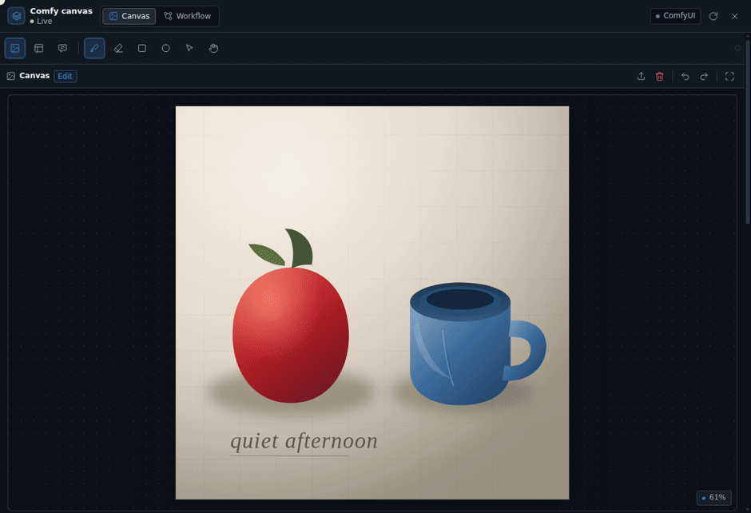
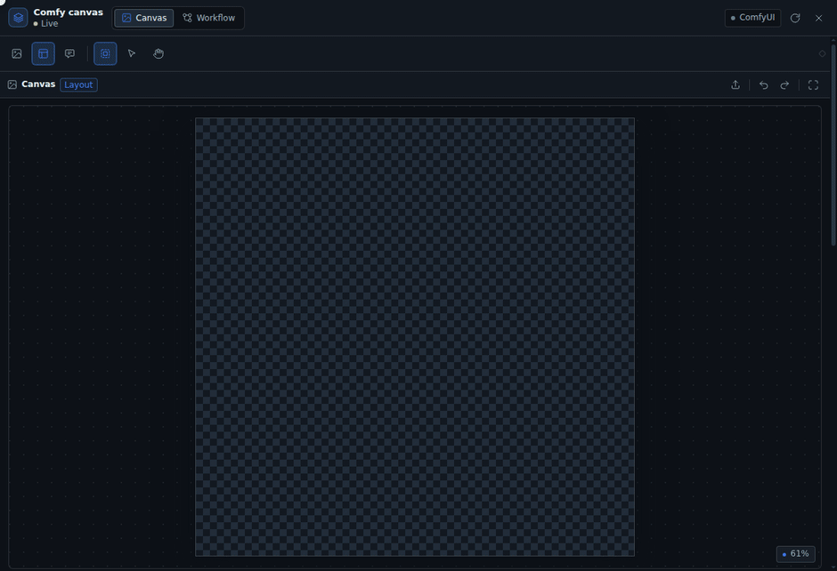

# DSH Comfy Cowork

[English](README.md) · 中文 · [日本語](README.ja.md)

在 DSH 右侧栏打开一块画布，人和 agent 共用同一份画布状态，直接对接 ComfyUI。

- 画布是共享状态，不是聊天附件：人画的蒙版、拉的框、写的提示词，agent 能读到；agent 写的提示词落在同一个输入框里。
- 产物直接喂 ComfyUI：蒙版是 ComfyUI 能读的 PNG，布局是 MOSS-Image 能直接当 conditioning 的 JSON，工作流就是 ComfyUI 自己保存的那份。
- 本地优先：图片只在浏览器、DSH 和本机 ComfyUI 之间流动。

界面语言：中文、English、日本語。其他语言回退到英文。

## 演示

### Agent 写提示词、搭工作流


提示词写进插件提示词框，不会只留在聊天里；工作流页能浏览节点图、选中节点改参数。

### 局部修正：手绘精确蒙版



画笔、橡皮、矩形、椭圆画同一张蒙版；羽化、扩展、反转之后导出 ComfyUI 可直接使用的 PNG。

### 布局编排（MOSS-Image）



空白画布拉框，逐框写 caption 和可见文字，提示词框实时变成编译后的单行 layout JSON。

### 评论批注


在图上圈出问题、写下改法；agent 读这一块的截图和文字，按批注改图。

## 安装

在 DSH 的「插件」页面点「添加插件」，输入包名 `dsh-comfy-cowork`，安装源保持默认的「npm 官方源」，点安装。

安装包带着构建好的客户端文件：装插件的机器不需要 Node，不需要构建，也不需要放行安装脚本。

刷新 DSH 页面，在聊天里输入 `/dsh-comfy-cowork`。右侧栏打开画布，同时把这个会话的 `comfy_coworking_*` 工具接到该会话的 agent 上。其它会话看不到这些工具。

关闭画布不会带走工具：模型看到的工具列表保持不变，前缀缓存继续命中。appbar 上的卸载按钮才会移除工具，点之前会先警告——工具列表一变，整段对话要重新处理一次且不命中缓存。对话较长时，先压缩再卸载。

默认连接 `http://127.0.0.1:8188`。改地址：编辑 `cordis.patch.yml` 里的 `baseUrl`，或在 profile 的 patch 层覆盖 `comfy-cowork` 行的 `config.baseUrl`。

## 用法

### 局部改图

1. 在画布载入图片：文件选择、拖拽、粘贴，或从 ComfyUI 的结果回填。
2. 用画笔、橡皮、矩形或椭圆画蒙版；调粗细、硬度、不透明度。
3. 调羽化、扩展/收缩、反转。蒙版以红色叠加显示。
4. 在「工作流」页载入包含 `LoadImage` / `LoadImageMask` 的工作流。注入绑定按节点类型和连线自动推断；要覆盖时在节点属性里设「画布注入」。
5. 填种子，点「排队运行」。结果出现在下方，可以「回填画布」继续迭代。

### 空白布局（MOSS-Image）

1. 切到「布局」模式，设画布宽高（MOSS 要求 16 的倍数）。
2. 用「拉框」画 bbox；每个框选 `object` / `character` / `text`，写 caption，`text` 类再写可见文字。
3. 提示词框自动变成编译后的 layout JSON，也可以手改。负面提示词写在独立的框里，运行时注入连到采样器 `negative` 的文本节点。
4. 载入含 `CreateBoundingBoxes` + `MOSSImageLayoutPrompt` 的工作流后运行。只有 `CLIPTextEncode` 时，插件直接注入编译后的 JSON。

布局框只对 MOSS-Image 有意义；anima、SDXL 等模型用提示词框跑普通工作流。

### Agent 协作

| 工具 | 作用 |
|---|---|
| `comfy_coworking_state` / `health` | 读画布、提示词、布局、绑定、运行记录；检查连接 |
| `comfy_coworking_set_prompt` | 写提示词或负面提示词 |
| `comfy_coworking_set_layout` / `upsert_box` / `remove_box` | 替换布局、增改删框 |
| `comfy_coworking_set_canvas` / `load_image` | 设尺寸与模式；把工作区图片载入画布 |
| `comfy_coworking_list_workflows` / `load_workflow` / `bind_workflow` | 浏览、载入、改绑定 |
| `comfy_coworking_list_models` | 列模型目录与文件 |
| `comfy_coworking_run` / `run_status` / `interrupt` | 运行、查状态、取消 |
| `comfy_coworking_open_canvas` | 请求 UI 打开画布 |
| `comfy_coworking_comments` | 读评论批注和对应截图 |

所有提示词写入都落在 `document.prompt`，也就是用户看到的那个输入框。

## 存储

```text
<workspace>/.comfy-cowork/<sessionId>/
  document.json        # 画布、提示词、布局、工作流、运行记录
  assets/
    canvas.png         # 当前画布原图
    source.png         # 原始导入图
    mask.png           # 白 = 编辑区
    canvas_rgba.png    # alpha = 1 - mask，供 LoadImage 的 MASK 输出
    run-*.png/mp4      # 运行产物
  runs/
```

## 兼容性

- ComfyUI `LoadImage` 的 `MASK` 输出是 **1 - alpha**。`canvas_rgba.png` 已按此反转；`mask.png` 保持白色 = 编辑区，适合 `LoadImageMask`。
- MOSS 编译逐字节对齐 `comfy_extras/nodes_moss_image.py`：
  `{"summary":{"caption":…},"items":[{"label":…,"caption":…,"bbox":[y1-H/2,x1-W/2,y2-H/2,x2-W/2]}],"bbox_coord_space":"abs_centralized","bbox_format":"yxyx"}`。
- `CreateBoundingBoxes` 的 `editor_state` 是 list 类型但 API 校验把 list 当 link；插件发 `"[]"` 字符串，实际框走 `bboxes` JSON。
- 浏览器不直连 ComfyUI：带 `Origin` 的请求会得到 403。所有请求由 DSH Host 代理。

## 开发

```bash
npm install     # esbuild + React，仅开发与测试
npm run build   # 生成 client.js（已 gitignore，构建产物）
npm test        # node:test，38 项
```

- Host：`index.js` → `lib/plugin.js`；工具在 `lib/tools.js`，路由在 `lib/routes.js`，工作流转换在 `lib/workflow.js`，MOSS 编译在 `lib/moss.js`。
- Client：`src/client/`，由 esbuild 打成 `client.js`；入口 `entry.jsx`，画布 `CanvasStage.jsx`，工作流 `WorkflowView.jsx`。
- 浏览器夹具在 `tests/harness/`，不属于运行时包。
- 改了 Host 代码后，用 `plugin_manager` 把 `include:comfy-cowork` 关掉再打开。改了 Client 代码后重新构建并刷新页面。
- 本地开发安装：`plugin_manager(action: "install_bundle", target: "/path/to/dsh-comfy-cowork")`。
- `client.js` 是构建产物，不提交；clone 后 `npm install` 会通过 `prepare` 自动构建。
- 发布：`npm publish`。`prepack` 会先构建 `client.js` 并跑测试，发布包里带的是构建产物。

需求文档：[docs/REQUIREMENTS.md](docs/REQUIREMENTS.md)。

## 限制

- 子图工作流会明确报错，暂不支持。
- API 格式的工作流可以运行和保存，但图视图只读。
- 单个 ComfyUI 服务器；多 profile 留到后续版本。
- 视频只做通用工作流运行与预览，不做时间轴。
- 大图蒙版按全分辨率处理；4K 以上建议先缩小画布。

## 致谢

界面设计使用了 [ui-ux-pro-max](https://github.com/nextlevelbuilder/ui-ux-pro-max-skill) 技能；文档写作使用了 [Agent Toolkit](https://github.com/softaworks/agent-toolkit) 的 `writing-clearly-and-concisely` 技能。

## 许可

MIT。见 [LICENSE](LICENSE)。
